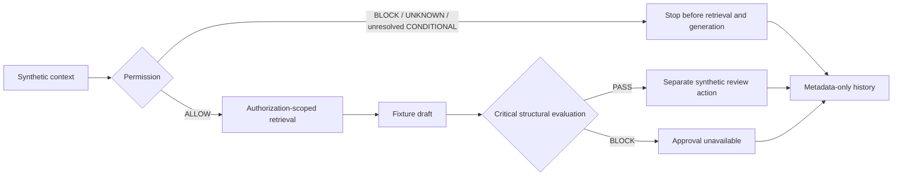
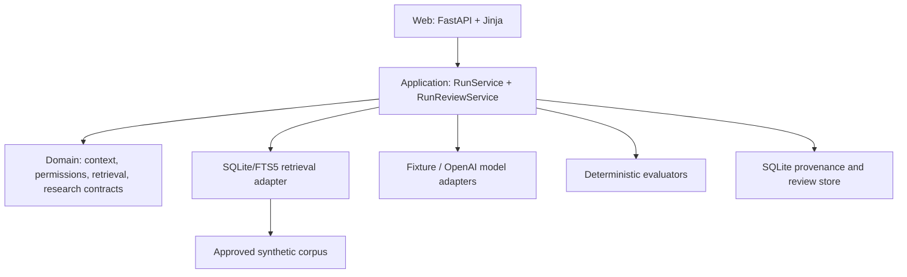

# PriviLAB

**A reference implementation for controlled, permission-aware AI workflows.**

Built by [Data Strategy Lab](https://github.com/DataStrategyLab), PriviLAB shows
how an application can check permission before retrieving source content, evaluate
a draft before approval, keep review decisions separate, and retain useful run
metadata. Legal and regulated environments motivate the design; the runnable
examples use synthetic data and fixed fixture answers.

**Creator & Lead Architect: Andrew Tsintsiruk.**

**Planned source-only release: v0.1.0 Developer Preview, October 21, 2026.**
The repository is not published yet. Final publication approval and the remaining
qualification work are tracked in the [release status](docs/release-status.md).
This is a local reference implementation with no production, legal-quality,
security-certification or prospect-demo readiness claim.

## Try it locally

Use macOS or Linux with Git, a POSIX shell, make, curl, tar and a SHA-256 utility.
Bootstrap provisions the repository-pinned tools and Python 3.13.15.

```sh
git clone https://github.com/DataStrategyLab/privilab.git
cd privilab
./scripts/bootstrap.sh --ci
make ci
make preview
```

Open [http://127.0.0.1:8000](http://127.0.0.1:8000). Select **Standard synthetic
researcher**, then **Run scenario**. Inspect permission, source metadata, draft,
evaluation, and the separate review controls. No API key or paid model call is
needed. Stop the preview with Ctrl-C.

See [Getting started](docs/getting-started.md) for expected scenarios, fresh
databases, configuration, containers and troubleshooting. The clone command
requires repository access until the owner makes the repository public.

## What it demonstrates



The application owns permission, retrieval scope, evaluation and review rules.
Untrusted source instructions and model output cannot grant permission, invoke
tools or approve release. An automated PASS means the defined structural criteria
passed; qualified substantive review and release decisions remain separate.

| Implemented capability | Scope |
| --- | --- |
| Context and permission contracts | Synthetic user/role/client/matter/workflow; ALLOW, CONDITIONAL, BLOCK and UNKNOWN |
| Scoped retrieval | SQLite/FTS5 filters before source content reaches model context |
| Fixture generation | Versioned fixed outputs for offline development and demonstrations |
| Model-provider contract | Fixture provider and OpenAI adapter; preview and CI use fixtures |
| Critical evaluation | Authorized-source, citation-resolution, permission-boundary and provenance-completeness checks |
| Review controls | Approve, Reject or Request revision; one immutable synthetic decision per run |
| Traceability | Run/configuration/source/evaluation/review metadata; history does not replay answer bodies |
| Local live smoke | Separately gated opt-in execution and usage/latency/conditional cost evidence |
| Verification | Repository contracts, fixtures/licenses, package build, lint/types, tests, smoke/golden and secret scans |

## Architecture

Python 3.13, FastAPI, Jinja templates and local SQLite/FTS5 form a modular monolith.
The browser interface is server-rendered and has no frontend build requirement.



Read [System architecture](docs/architecture/system.md),
[Trust boundaries](docs/architecture/trust-boundaries.md) and the
[accepted decisions](docs/decisions/README.md). These diagrams describe existing
code; this release-documentation work introduces no new runtime or architecture.

## Safe failure and evaluation

- **BLOCK** denies protected progression.
- **UNKNOWN** fails closed when required context or permission evidence is missing.
- **CONDITIONAL** stops while required conditions are unresolved.
- A generated draft with a missing/non-resolving required citation receives an
  automated **BLOCK**, and approval is unavailable.
- Reject and Request revision are synthetic UI decisions. Request revision does
  not create a revision workflow; a subsequent execution gets a new run ID.

The six trade/regulatory golden scenarios include an allowed draft, insufficient
source, permission stop, missing citation, citation challenge and instruction
attack. All remain internal DRAFT fixtures pending qualified domain review and
prospect eligibility decisions. Passing a negative test means the expected stop
or BLOCK occurred, not that the draft was approved. See
[Evaluation and scenarios](docs/evaluation.md).

## Model execution and retained data

The normal preview runs fixed answers through the same permission, evaluation and
review boundaries. The OpenAI adapter is configured in source for
`gpt-5.6-terra`; that configured alias is not proof of current service availability
or a pinned dated model snapshot. [Local live smoke](docs/architecture/live-eval.md)
requires explicit opt-in, credentials and approved public/synthetic inputs.
It is outside CI; the hosted live-eval workflow remains deliberately blocked.

Generated answer, prompt/query and retrieved source bodies are transient. Stored
history contains metadata, not an answer replay. `synthetic-local-reviewer` is a
fixed demo identity, without production authentication. Local execution and
`store=false` do not establish provider privacy, retention, privilege or compliance
assurances. See [Capabilities and limitations](docs/capabilities.md).

## Documentation

| Need | Start here |
| --- | --- |
| Install and run | [Getting started](docs/getting-started.md) |
| Reproduce verification | [Reproducibility](docs/reproducibility.md) |
| Understand the implementation | [Architecture](docs/architecture/system.md) and [capabilities](docs/capabilities.md) |
| Understand tests and scenarios | [Evaluation](docs/evaluation.md) |
| Find the rest of the docs | [Documentation index](docs/README.md) |
| Contribute | [Contributing](CONTRIBUTING.md) and [Code of Conduct](CODE_OF_CONDUCT.md) |
| Report a vulnerability privately | [Security policy](SECURITY.md) |
| Understand content and reuse rights | [License guide](licenses/README.md) and [data policy](DATA_HANDLING.md) |
| Track shipped versus planned work | [Changelog](CHANGELOG.md), [roadmap](ROADMAP.md) and [release status](docs/release-status.md) |

## Contributing and licensing

Open a [GitHub issue](https://github.com/DataStrategyLab/privilab/issues) with a
bounded proposal or reproducible non-sensitive bug report. Maintainers route
accepted work into the repository's issue, CI and review process. Contributors
need no private Linear access. AI-assisted changes receive the same review and
data restrictions as other contributions.

Project-authored code and original project-authored documentation/synthetic
fixtures are offered under [Apache License 2.0](LICENSE), subject to applicable
third-party notices. Adapted or separately licensed material retains its stated
terms. [NOTICE](NOTICE) and [third-party notices](THIRD_PARTY_NOTICES.md) explain
attribution and scope. The license does not grant trademark rights to PriviLAB or
DSL branding, or relicense third-party dependencies.

This reference implementation does not provide legal advice, an ethics opinion,
a privilege/compliance determination, an accuracy/confidentiality guarantee,
production fitness or a vendor partnership/endorsement. Hosted deployment, DMS/
production identity integration, other providers and fine-tuning are roadmap work.
