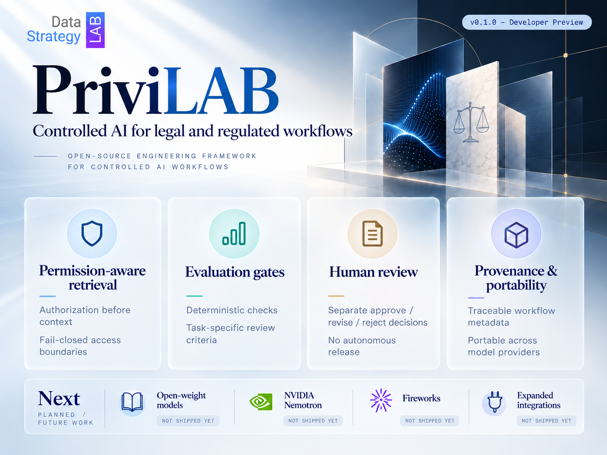
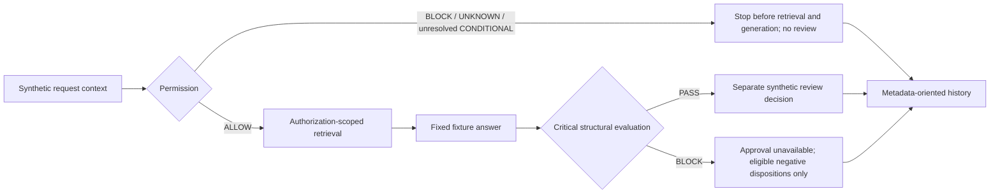
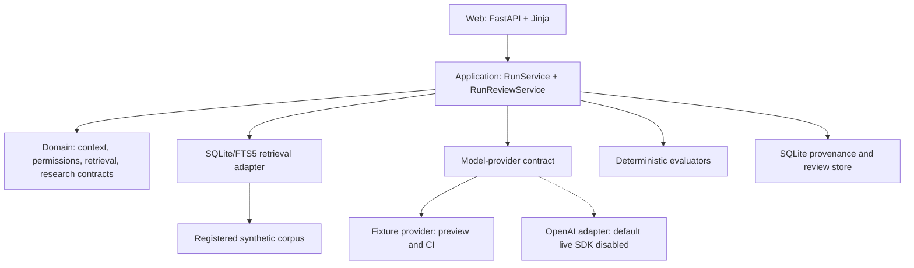

# PriviLAB



**An open-source engineering framework for controlled, firm-specific legal AI.**

**Permissions before context. Testable evaluation gates. Separate human review.**

PriviLAB makes selected legal-AI workflow controls **inspectable, testable, and
extensible**. Developed by [Data Strategy Lab LLC (DSL)](https://github.com/DataStrategyLab),
it brings application-defined permissions, authorization-scoped retrieval,
source-reference checks, deterministic evaluation, human-review decisions, and
metadata-oriented provenance into one reference implementation.

The first Developer Preview uses **synthetic trade and regulatory research
scenarios with fixed fixture answers**. It gives law-firm technology leaders and
engineers a concrete way to examine how firm-specific requirements can become
software behavior, without treating a reference implementation as a qualified
enterprise system.

**Andrew Tsintsiruk · Creator & Lead Architect**

> [!IMPORTANT]
> **v0.1.0 — Developer Preview is source-only.** It is for source inspection,
> architecture review, and contribution. Fresh networked native setup and Docker
> execution remain **ON HOLD**; default live-model SDK execution is **DISABLED**.
> This preview is **not approved for client-matter processing, prospect
> demonstrations, hosted use, or production deployment**. See
> [release status and setup qualification](docs/release-status.md).

[Capabilities](#whats-included) · [Source-first exploration](#source-first-exploration) ·
[Architecture](#architecture) · [Roadmap](#roadmap) ·
[Documentation](#documentation) · [Contributing](#contributing)

## Why PriviLAB

A useful legal-AI workflow needs more than a capable model. It needs explicit
answers to what information may be retrieved, which checks must pass, what should
happen when evidence is insufficient, and who may make the next decision.

PriviLAB places those questions in application code rather than relying on a
prompt to enforce them. Its focus is the surrounding workflow: **access before
context, structural evaluation before approval eligibility, separate review, and
bounded evidence retention**.

| Audience | What PriviLAB helps you examine |
| --- | --- |
| CIOs, CTOs, and firm leadership | Control placement, application trust boundaries, and build, buy, extend, or integrate decisions |
| AI, innovation, knowledge-management, and legal-technology teams | Concrete permission context, evaluation criteria, review eligibility, and scenario-specific failure behavior |
| Engineers, information-governance, security, and risk teams | Executable contracts, source-access boundaries, adversarial tests, and the distinction between technical checks and organizational authority |

Legal technology is the first focus. These patterns may also inform adjacent
regulated environments, but each additional workflow requires its own authorized
data, requirements, evaluation, substantive review, and release decision.

## What's included

The following capabilities exist in the **v0.1.0 source**. Their presence does not
lift the execution restrictions below.

| Capability | Implemented behavior and boundary |
| --- | --- |
| **Permission decisions** | Typed synthetic user, role, client, matter, and workflow context; `ALLOW`, `CONDITIONAL`, `BLOCK`, and `UNKNOWN`. Missing authority and unresolved conditions stop protected progression before retrieval or generation. This is application authorization, not production identity or legal permission. |
| **Authorization-scoped retrieval** | SQLite/FTS5 filters registered synthetic content within an application-created access scope before source text enters model context. Stable source and chunk identifiers support reference checks; there is no live DMS connection. |
| **Fixture generation** | Versioned, fixed outputs support controlled scenarios. Preview and ordinary CI use fixtures, not live inference. Repeatability does not measure real-world model performance. |
| **Critical structural evaluation** | Four checks cover authorized-source membership, citation resolution, permission boundaries, and provenance completeness. Critical failures prevent approval eligibility; they are not legal-quality scores. |
| **Separate human-review decisions** | Approve, Reject, or Request revision where eligible, with one immutable synthetic review decision per eligible run. Permission-stopped runs are not reviewable. |
| **Metadata-oriented provenance** | Relevant run, configuration, permission, source/chunk, provider, evaluation, and review metadata is retained. History does not retain or replay generated answer bodies. |
| **Provider boundary** | A fixture provider and an OpenAI adapter are present. The default live SDK client is disabled; offline fake-SDK tests do not establish live-service or TLS qualification. |
| **Verification infrastructure** | Repository contracts, fixture/license validation, package-build checks, linting, type checks, automated tests, deterministic smoke/golden scenarios, and secret scans. Execution requires an approved environment. |

See [Capabilities and limitations](docs/capabilities.md) for the detailed scope.

## How the controlled workflow works



The application owns permission, retrieval scope, evaluation, and review rules.
Permission states are distinct from Legal AI Readiness G1/G2/G3.
Retrieved instructions and model output do not confer permission, tool authority,
or release approval. Evaluation or evidence-persistence failure cannot create a
passing result. The diagram summarizes the control path; it is not a guarantee
that execution succeeds or that evidence can always be persisted.

### What a structural PASS means

A `PASS` means only that the four defined structural checks passed. Citation
resolution does **not** establish that a source is current, authoritative, or
supports a legal proposition. An insufficient-evidence response may pass these
checks while remaining substantively incomplete.

The six original synthetic trade/regulatory scenarios cover an allowed draft,
insufficient evidence, a permission stop, a missing citation, a non-resolving
citation, and an instruction-attack fixture. All remain **internal DRAFT material
pending qualified domain review and applicable prospect-demo approval**. Passing
a negative test means the expected stop or `BLOCK` occurred, not that the answer
was approved. Synthetic instruction-attack coverage does not establish general
live-model prompt-injection resistance.

### What a review decision means

Reviewer identity is synthetic, not authenticated enterprise identity. A generated
draft with a critical `BLOCK` cannot be approved, although eligible Reject or
Request revision decisions remain available. Request revision records a
disposition; it does not launch a revision workflow or establish revision lineage.
A subsequent execution receives a new run ID.

**Neither an automated PASS nor a UI approval authorizes client delivery,
publication, or a software release.** See [Evaluation and scenarios](docs/evaluation.md).

## Source-first exploration

Start with [release status](docs/release-status.md),
[capabilities](docs/capabilities.md), and the
[system architecture](docs/architecture/system.md). Source inspection and
documentation contributions do not require running the application.

| Activity | v0.1.0 status |
| --- | --- |
| Source inspection, architecture review, and documentation contribution | **Available without application execution.** Follow contribution and data-handling rules. |
| Fresh native networked bootstrap or setup | **ON HOLD.** There is no approved public networked installation path. |
| Offline fixture verification and localhost preview | **Restricted.** Requires an existing, separately approved environment with the required locked tools and inputs already provisioned. |
| Docker and successor images | **ON HOLD.** Retained Dockerfile/bootstrap source is not an approved build, run, or deployment procedure; successor-image qualification remains unresolved. |
| Default live-model SDK execution | **DISABLED** before credential access or HTTP-client construction. Credentials and opt-in flags do not override the restriction. |
| Native TLS and certificate trust | **UNRESOLVED.** Disabling the live client does not remediate TLS, validate affected-chain rejection, or qualify host trust. The separate unmerged CA-trust prototype is excluded. |
| Client-matter, prospect-demo, hosted, or production use | **NOT APPROVED.** Source availability does not change these boundaries. |

Older quickstart, bootstrap, container, and live-evaluation instructions do not
provide current execution authorization. Do not bypass certificate or hostname
verification, acquire unreviewed tooling, or substitute environments to work
around the holds.

Docker remains on a temporary security-qualification hold. The Dockerfile is an
engineering reference; do not build, run or expose it for general use while the
hold applies.

<details>
<summary><strong>Fixture-only commands: existing, separately approved offline environments only</strong></summary>

These are **not fresh-install instructions**. Use them only after confirming that
your existing environment is separately approved and already contains all required
locked tools and inputs. Otherwise, inspect the source and coordinate verification
with maintainers.

```sh
make ci
make preview
```

For that approved fixture preview, open [http://127.0.0.1:8000](http://127.0.0.1:8000),
select **Standard synthetic researcher**, and choose **Run scenario**. Inspect
permission outcomes, source metadata, the draft, evaluation, and separate review
controls. No API key or paid model call is needed. Stop the preview with `Ctrl-C`.

See [Getting started](docs/getting-started.md) and
[Reproducibility](docs/reproducibility.md) for the retained engineering instructions,
subject to [local setup qualification](docs/release-status.md#local-setup-qualification).

</details>

## Architecture

PriviLAB is a **Python 3.13 modular monolith** built with FastAPI, Jinja templates,
and local SQLite/FTS5. The browser interface is server-rendered and requires no
frontend build. Typed domain and provider contracts separate workflow rules from
model, retrieval, and storage implementations.



These are implemented boundaries, not a general-purpose autonomous-agent runtime.
Production identity, DMS integration, model-controlled tools, runtime MCP
connectors, hosted service, and enterprise deployment qualification are **not
included in v0.1.0**. Provider abstraction alone does not establish equivalent
behavior across untested models.

Read [System architecture](docs/architecture/system.md),
[Trust boundaries](docs/architecture/trust-boundaries.md), and
[Architecture decisions](docs/decisions/README.md).

## Model execution and retained data

The fixture path exercises permission, evaluation, and review behavior without
live inference. The OpenAI adapter and local live-smoke implementation remain in
source with offline fake-SDK coverage, but the default live SDK client cannot be
constructed in this preview. The hosted live-evaluation workflow also remains
blocked. Offline transport tests do not qualify TLS.

The configured `gpt-5.6-terra` alias in source is not proof of current service
availability or a pinned dated model snapshot. See
[Local live-smoke architecture](docs/architecture/live-eval.md) for the implementation
reference, not authorization to enable live execution.

Application run history retains relevant metadata. It **does not retain**
generated answer bodies, prompt/task/query text, source bodies, raw provider
payloads, credentials, or raw exceptions. Reopening a run reads metadata; it does
not replay retrieval, generation, or evaluation, or reconstruct the original
answer.

This is a boundary for **application run history**, not a provider-side retention
guarantee or comprehensive forensic audit. Local execution, a provider flag such
as `store=false`, or a synthetic reviewer identity does not establish
confidentiality, privilege, compliance, or production authentication.

## Roadmap

[ROADMAP.md](ROADMAP.md) tracks public engineering direction;
[CHANGELOG.md](CHANGELOG.md) records changes and
[release status](docs/release-status.md) records execution restrictions. The areas
below are **not shipped capabilities or delivery commitments**.

| Research direction | Questions to investigate |
| --- | --- |
| **Governed firm knowledge** | Authoritative document-system permissions, matter context, access revocation, and source-quality controls without a competing permission system by default |
| **Bounded agent and tool authority** | Separate read/write/action permissions, tool-call authorization, information-flow checks, adversarial tests, and human gates for consequential actions |
| **Deeper legal-workflow evaluation** | Proposition-to-source support, authority currency, qualified reviewer calibration, adversarial regressions, and protected holdout studies |
| **Review and value measurement** | Authenticated reviewer attribution, rework, turnaround, cost, and accepted-output quality after representative validation |

NVIDIA Nemotron-family models, other eligible open-weight models, Fireworks AI
inference/training experiments, and workflow-specific fine-tuning remain
[planned research — not shipped in v0.1.0](ROADMAP.md#planned-model-research--not-shipped-in-v010).
**No NVIDIA Nemotron or Fireworks integration or fine-tuned PriviLAB model is
included in v0.1.0.** Any expansion requires its own
architecture, licensing, data-handling, evaluation, and deployment review;
mentioning a provider does not imply partnership or endorsement.

Possible future workflows include firm knowledge retrieval, regulatory-change
research, evidence synthesis, playbook-guided review, and legal operations. Each
requires separate validation. Runtime agents, tools, or MCP connectors must not
be inferred from these research directions.

## Documentation

| Need | Start here |
| --- | --- |
| Confirm execution restrictions | [Release status and local setup qualification](docs/release-status.md) |
| Understand implemented scope | [Capabilities and limitations](docs/capabilities.md) |
| Review architecture and controls | [System architecture](docs/architecture/system.md), [trust boundaries](docs/architecture/trust-boundaries.md), and [decisions](docs/decisions/README.md) |
| Understand scenarios and verification | [Evaluation](docs/evaluation.md) and [reproducibility](docs/reproducibility.md) |
| Explore the approved fixture path | [Getting started](docs/getting-started.md), subject to the execution restrictions above |
| Track changes and future direction | [Changelog](CHANGELOG.md) and [roadmap](ROADMAP.md) |
| Understand responsibilities | [Governance](GOVERNANCE.md) and [contributors](CONTRIBUTORS.md) |
| Contribute | [Contribution guide](CONTRIBUTING.md), [repository instructions](AGENTS.md), and [Code of Conduct](CODE_OF_CONDUCT.md) |
| Get non-sensitive help | [Support](SUPPORT.md) |
| Report a vulnerability privately | [Security policy](SECURITY.md) |
| Understand permitted data and reuse | [Data-handling policy](DATA_HANDLING.md), [license guide](licenses/README.md), and [third-party notices](THIRD_PARTY_NOTICES.md) |
| Browse all documentation | [Documentation index](docs/README.md) |

## Contributing

Contributions are welcome in source review, documentation, original synthetic
scenarios, regression tests, and evidence-backed architecture proposals.

Start with a bounded proposal or reproducible, non-sensitive report in
[GitHub Issues](https://github.com/DataStrategyLab/privilab/issues). Public
contributors and coding agents can use GitHub issues/PRs, repository instructions,
ADRs, and tests without access to DSL's private Linear or Drive systems. Developers
without a separately approved runtime environment should coordinate verification
with maintainers rather than provision unreviewed tooling.

Changes need a clear requirement, bounded scope, applicable tests and evaluations,
and independent review with non-author human approval. **AI-assisted changes meet
the same standards as human-authored changes**; generated findings and patches are
not their own authority. Follow [CONTRIBUTING.md](CONTRIBUTING.md) and
[GOVERNANCE.md](GOVERNANCE.md). Andrew retains final merge and release authority.

Use only public, synthetic, properly anonymized/redacted, or appropriately licensed
materials within the contribution rules. Never submit client matters, privileged
or work-product content, identifiable engagement restrictions, restricted legal
databases, credentials, secrets, or sensitive vulnerability evidence.

### Security and support

Report security concerns privately through [SECURITY.md](SECURITY.md), not public
issues, pull requests, screenshots, logs, or attachments. Use [SUPPORT.md](SUPPORT.md)
for non-sensitive questions. Source availability is not permission to expose
restricted data or bypass execution holds.

## License, attribution, and distribution

Project-authored code, original documentation, and original synthetic fixtures are
provided under [Apache License 2.0](LICENSE), subject to [NOTICE](NOTICE) and
[third-party terms](THIRD_PARTY_NOTICES.md). Adapted or separately licensed
materials retain their stated terms; the repository license does not relicense
third-party dependencies or model weights. The included DSL logo may accompany
the source distribution, while **DSL and PriviLAB trademark and endorsement rights
remain reserved**.

The hero's [asset attribution and use terms](docs/assets/privilab-developer-preview-hero.LICENSE.md)
cover its included branding; Apache-2.0 does not grant rights to third-party marks.

The project recognizes **Adaora Orakwue** for engineering and technical-review
contributions during earlier development, and **Naveen Gali** for engineering and
maintenance. Original Git authorship is preserved. Contributor recognition is
distinct from current maintainer, code-review, and release-approval authority;
see [CONTRIBUTORS.md](CONTRIBUTORS.md).

| Release detail | Scope |
| --- | --- |
| Version | `v0.1.0` — Developer Preview |
| Distribution | Source-only pre-release; GitHub-generated source ZIP/tar archives only |
| License | Apache-2.0 for project-authored material, subject to notices and third-party terms |
| Reviewed source baseline | [`21baa4ccdc468bd6a30681344eb8ec3df752790a`](https://github.com/DataStrategyLab/privilab/tree/21baa4ccdc468bd6a30681344eb8ec3df752790a) |
| Release-notes review date | October 23, 2026 |
| Published | [October 23, 2026](https://github.com/DataStrategyLab/privilab/releases/tag/v0.1.0); source-only GitHub pre-release |

No Python wheels, compiled binaries, bundled runtimes/dependencies, Docker images,
or hosted service are distributed as release assets. This README describes the
scope recorded in the release notes for the reviewed source baseline.
[GitHub Releases](https://github.com/DataStrategyLab/privilab/releases) is the
authoritative record of actual publication status, date, tag, and downloadable
source archives. A repository's visibility or package-version string alone does
not establish publication.

## About Data Strategy Lab

**Data Strategy Lab LLC (DSL)** is a Washington, D.C.-area AI strategy and
engineering firm helping law firms move from experimentation toward practical,
governed workflows. DSL combines vendor-neutral strategy with hands-on work in AI
readiness, firm-specific applications, workflow automation, enterprise knowledge
integration, retrieval-augmented generation, evaluation, and governance.

PriviLAB opens selected engineering patterns behind that approach for inspection
and contribution. This Developer Preview does not establish a client deployment,
independently validated productivity gains, ROI, a protected legal-task holdout
benchmark, or generalizable legal-quality performance.

DSL is not a law firm. PriviLAB does not provide legal advice, validated legal work
product, an ethics opinion, a privilege or confidentiality conclusion, a compliance
determination, security certification, guaranteed accuracy, zero hallucinations,
client approval, or production fitness.

**Explore the source. Review the controls. Contribute evidence-backed improvements.**

---

**PriviLAB is an implementation reference, not a certification or legal determination.**
