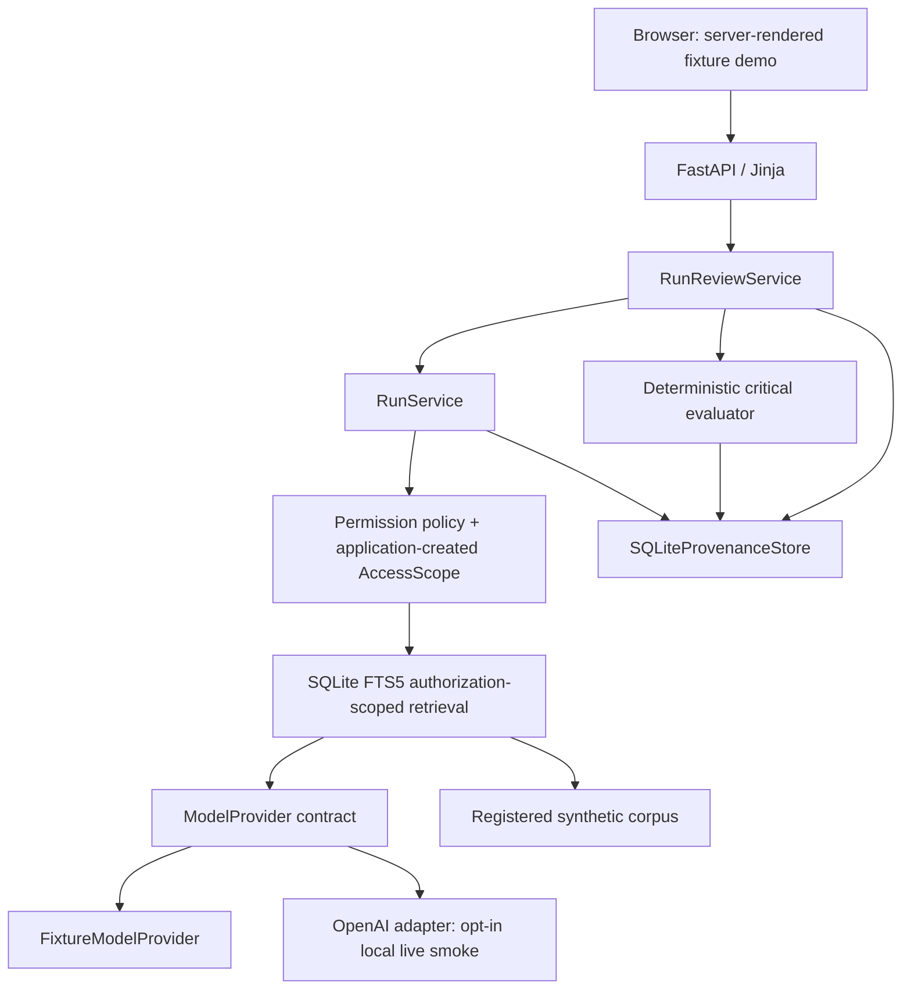
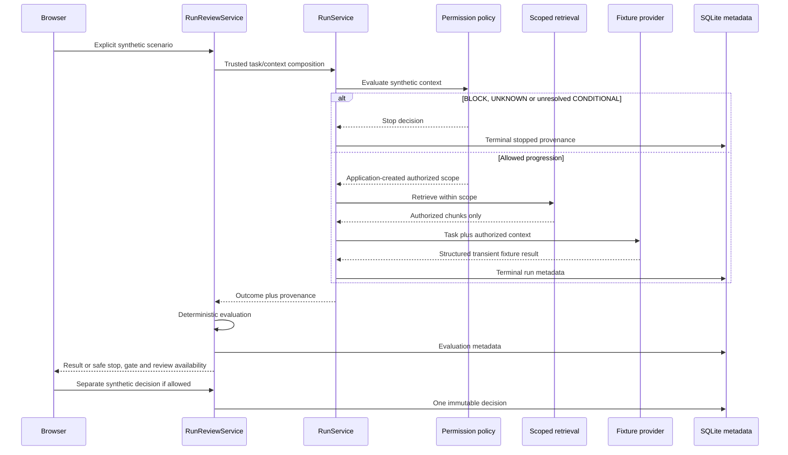

# System architecture

PriviLAB implements the accepted Python modular-monolith architecture. FastAPI
and Jinja render a local synthetic preview; SQLite/FTS5 supports scoped retrieval
and SQLite stores minimum provenance/evaluation/review metadata. This describes
current code, without changing the [accepted ADRs](../decisions/README.md).

## Components

| Package | Responsibility |
| --- | --- |
| `domain` | Typed context, permission, source/retrieval and research contracts |
| `application` | Permission policy, authorized scope, RunService, RunReviewService and telemetry |
| `adapters/retrieval` | SQLite/FTS5 filtering and stable source/chunk identity |
| `adapters/models` | Versioned fixture outputs and approved OpenAI adapter |
| `adapters/storage` | Typed immutable provenance, evaluation, review and telemetry persistence |
| `evals` | Criteria/contracts, deterministic smoke/golden runners and local live-smoke entry |
| `web` | Server-rendered scenario/result/history presentation and local assets |

## Request sequence

Terminal run provenance exists before evaluation; evaluation failure does not
remove that history or imply eligibility. Stopped runs remain NOT REVIEWABLE.
Generated critical BLOCK disables approval, while negative review actions remain
available. A local review decision does not authorize a repository/product release.

## History and providers

History reads stored metadata; it does not repeat retrieval, generation or
evaluation and retains no answer/task/query/source bodies. The retrieval index
is transient. Stored configuration/hash and source/chunk IDs identify the run,
without claiming that metadata can replay the complete answer.

The fixture path is the default preview/CI. The OpenAI adapter uses the sanctioned
RunService composition and configured model alias, preserving permission before
model context. Its live smoke is separately gated and records typed usage/latency/
conditional-cost evidence. No mutable last-call state or model-controlled tools
are introduced. See [live-smoke details](live-eval.md).

## Environments and boundaries

The implemented native source preview is local and uses public/synthetic inputs;
its uv/Python bootstrap qualification remains pending.
[ADR-008](../decisions/ADR-008-preview-deployment.md) permits localhost preview and
local containers as the architectural scope. The current container setup is on a
temporary security-qualification hold for this Developer Preview; the hold does
not supersede ADR-008's architectural decision. During the hold, the Dockerfile
remains an engineering reference rather than a recommended public setup.
Existing executable Makefile targets do not lift the hold or authorize operation.
See [local setup qualification](../release-status.md#local-setup-qualification)
for current restrictions. Historical container observations retain their original
scope; no deployment behavior changes are introduced here.

No hosted runtime, production identity/DMS integration, autonomous framework or
runtime MCP is part of this architecture. Post-bootstrap `make ci` is offline and
secret-free. [Trust boundaries](trust-boundaries.md) explain the control/authority
separation.
