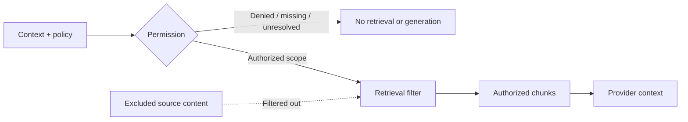

# Trust boundaries

## Untrusted content

User text, source material, task/fixture content and model output are untrusted.
They cannot grant permission, select runtime tools, change evaluators or create
human review/release authority. Instruction-attack fixtures exercise bounded
controls; they do not establish general live-model immunity.

## Authorization before context

The application evaluates synthetic permission and creates an explicit
AccessScope. Retrieval filters sources against that scope before source content
enters provider context. BLOCK, UNKNOWN and unresolved CONDITIONAL stop protected
progression; runtime labels are distinct from Legal AI Readiness G1/G2/G3.

## Provider, evaluation and review

ModelProvider supplies a structured result behind an application-owned interface.
Providers cannot broaden scope, invoke tools, modify rubric/gate results or approve
work. Deterministic criteria validate structural source/citation and provenance
boundaries; a qualified human separately assesses substantive adequacy.

Generated critical BLOCK disables approval. Stopped runs are not reviewable.
Evaluation execution/persistence failure fails closed. The local reviewer identity
is synthetic, without production authentication; its immutable decision is not
legal/client approval or a product release decision.

## Data and persistence

Only registered public/synthetic/anonymized/redacted/properly licensed materials
belong in the repository. Client/matter/DMS content, privileged material, restricted
legal databases, credentials and private security findings remain excluded.
The FTS index and answer/source bodies are transient. Stored provenance validates
metadata; it does not authenticate a deliberately forged local database or retain
an answer replay. See [data handling](../../DATA_HANDLING.md).

## Engineering and publication

User-level Linear engineering integration is not a runtime dependency or permission
to transmit protected content. Existing Codex workspace restrictions remain in
force; this documentation change does not alter them.

Automated evaluation, dedicated Codex review, non-author human engineering approval
and Andrew's final merge/release decision remain separate controls. Source
publication, artifact redistribution, prospect demonstration and production use
have different review scopes. A roadmap/status notice supplies transparency, not
a waiver of unresolved required rights/security/publication findings.
